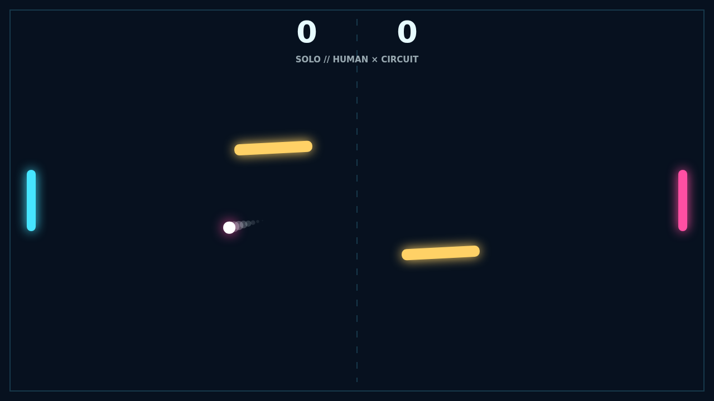
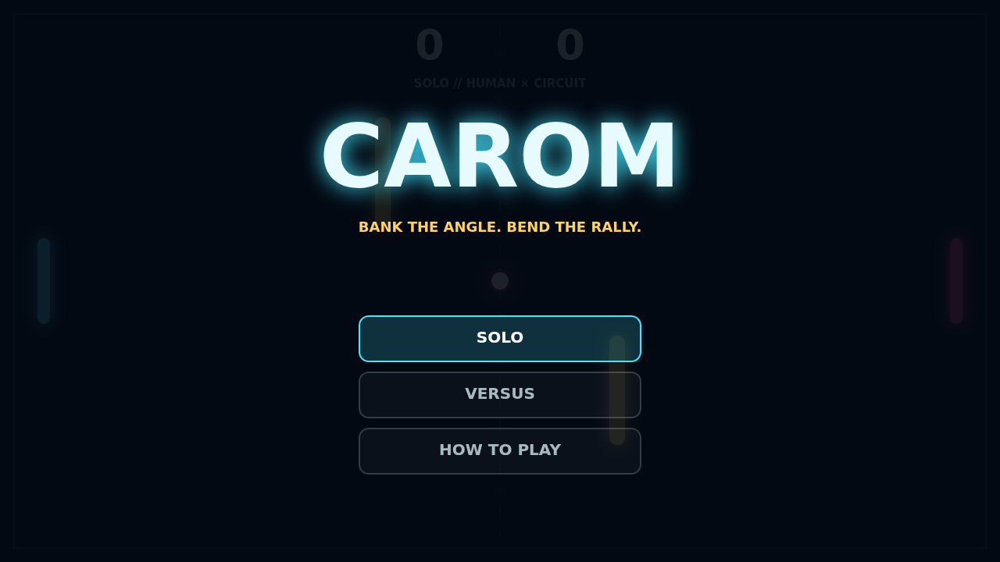

# Carom

The rally begins in a breath of stillness, then the ball tears toward the left
paddle. Every return makes it quicker. Meet it while moving and the shot takes
your paddle's spin, bending across the dark court instead of following a simple
straight line.

Two gold bars sway and rotate through the middle. Their changing faces turn a
safe return into a bank-shot puzzle: clip one cleanly to wrong-foot your rival,
or curve around it and catch the far edge of the paddle.

Play the circuit in Solo or share the keyboard for a local Versus duel. A match
runs to eleven and demands a two-point lead, so match point can become a long,
bright argument about angles.

